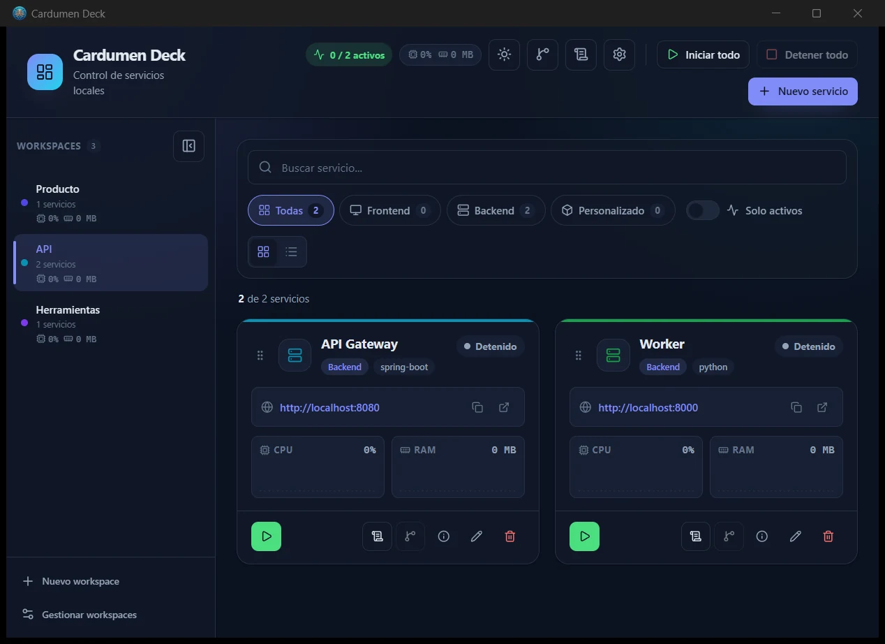
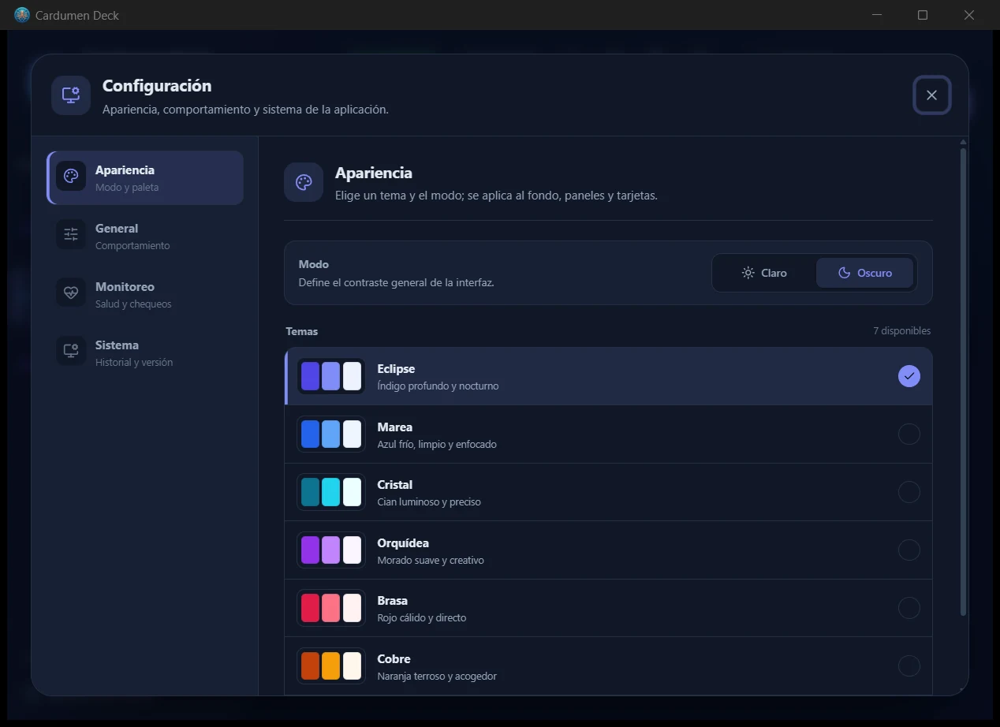

<p align="center">
  
</p>

<h1 align="center">Cardumen Deck</h1>

<p align="center">
  <strong>Many services, one current.</strong><br />
  Muchos servicios, una corriente.
</p>

<p align="center">
  <a href="https://github.com/DaniloGarrido/cardumen-deck/actions/workflows/ci.yml"></a>
  <a href="https://github.com/DaniloGarrido/cardumen-deck/releases/latest"></a>
  <a href="LICENSE"></a>
  
  
</p>

<p align="center">
  <a href="README.en.md">English</a> ·
  <a href="#descarga">Descarga</a> ·
  <a href="#desarrollo">Desarrollo</a> ·
  <a href="CHANGELOG.md">Changelog</a> ·
  <a href="SECURITY.md">Seguridad</a>
</p>

Dashboard local para Windows que centraliza el arranque, monitoreo y operación de servicios de desarrollo.

> **Estado:** preview temprana (`0.1.x`). Windows-only por ahora.



## Características

- Workspaces para agrupar servicios.
- Inicio, detención y reinicio de procesos locales.
- Detección de servicios activos y reconciliación de procesos huérfanos.
- Métricas de CPU, RAM y cantidad de procesos.
- Health checks HTTP, TCP y por proceso.
- Logs por ejecución y visor integrado.
- Integración Git: estado, ramas, checkout, pull, push, merge y conflictos.
- Detección de dependencias y entorno.
- Formulario guiado para crear servicios.
- Temas claro/oscuro y varias paletas.
- Registro interno de errores y actividad.



## Descarga

La forma recomendada es usar la última release:

- [Descargar la última versión](https://github.com/DaniloGarrido/cardumen-deck/releases/latest)
- **Portable:** `CardumenDeck-v*-windows-x64-portable.exe`. No requiere instalación.
- **Instalador:** `CardumenDeck-v*-windows-x64-setup.exe`. Instala la app con NSIS.
- Cada release incluye `SHA256SUMS.txt` para verificar integridad.

> La release `0.1.x` puede estar sin firmar. Windows SmartScreen puede mostrar una advertencia. Verifica el SHA256 antes de ejecutar y no desactives tu antivirus.

### Verificar el SHA256

```powershell
Get-FileHash .\CardumenDeck-v0.1.0-windows-x64-portable.exe -Algorithm SHA256
Get-Content .\SHA256SUMS.txt
```

## Requisitos

### Para usar la app

- Windows 10 u 11.
- WebView2 Runtime. Windows 10/11 modernos ya lo incluyen.
- Git para Windows si vas a usar las funciones Git.
- Git Credential Manager o credenciales configuradas si vas a hacer `push`/`pull` remotos.

No necesitas Node.js ni Rust para usar el portable o el instalador.

### Para desarrollar

- Node.js 24+ y npm 10+.
- Rust stable 1.85+.
- Visual Studio Build Tools con C++.
- WebView2 Runtime.
- Git para Windows.

## Primeros pasos

1. Abre Cardumen Deck.
2. Crea un workspace.
3. Agrega un servicio con nombre, carpeta de trabajo y comando.
4. Inicia el servicio desde su tarjeta.
5. Configura un health check HTTP, TCP o por proceso si quieres ver su estado.

## Datos y privacidad

- Configuración: `%APPDATA%\CardumenDeck\config.json`
- Runtime: `%APPDATA%\CardumenDeck\runtime.json`
- Logs: `%LOCALAPPDATA%\CardumenDeck\logs\`

Cardumen Deck no tiene backend remoto, analíticas ni telemetría. Los health checks consultan únicamente las URLs o puertos que configures. Las operaciones Git contactan el remoto solo cuando las ejecutas.

Si vienes de una versión anterior, la configuración, el runtime y el dashboard log se migran automáticamente la primera vez.

## Desinstalar

- **Portable:** elimina el `.exe`.
- **Instalador:** usa “Agregar o quitar programas” o el desinstalador de NSIS.
- Para borrar también tus datos, elimina:
  - `%APPDATA%\CardumenDeck`
  - `%LOCALAPPDATA%\CardumenDeck`

Después de migrar, las carpetas antiguas de `ServiceDashboard` se pueden eliminar si ya no las necesitas.

## Limitaciones conocidas

- Solo Windows.
- No hay auto-update; descarga una nueva release manualmente.
- La release `0.1.x` puede estar sin firma digital.
- Las funciones Git requieren Git instalado y credenciales configuradas para operaciones remotas.
- El instalador NSIS y el portable comparten la misma configuración local.

## Troubleshooting

### SmartScreen bloquea el ejecutable

Es esperado en binarios sin firma. Verifica el SHA256 y usa “Más información” → “Ejecutar de todas formas” solo si confías en el archivo.

### La app no abre o se ve en blanco

Comprueba que WebView2 Runtime esté instalado y actualizado. También revisa los logs en `%LOCALAPPDATA%\CardumenDeck\logs\`.

### Git no se detecta

Instala Git for Windows y asegúrate de que `git` esté en `PATH`. Reinicia Cardumen Deck después.

### Un servicio no arranca

Revisa la carpeta de trabajo, el comando, los argumentos y el log de la ejecución desde la tarjeta del servicio. Si el comando funciona en una terminal pero no en la app, revisa diferencias de `PATH` y variables de entorno.

### El puerto 1420 está ocupado en desarrollo

Cierra el proceso que esté usando el puerto o reinicia la sesión de desarrollo.

## Stack

- **Frontend:** Vue 3, TypeScript, Vite, Lucide.
- **Backend:** Rust, Tauri 2, Tokio.
- **UI:** WebView2.
- **Datos:** archivos JSON locales, sin backend remoto.

## Desarrollo

```powershell
git clone https://github.com/DaniloGarrido/cardumen-deck.git
cd cardumen-deck
npm install
npm run dev
```

La app de escritorio se abre con el frontend en modo desarrollo.

## Build

Desde la raíz del repo:

```powershell
# Ejecutable portable
npm run build -- --no-bundle

# Portable + instalador NSIS
npm run build
```

Rutas de salida:

- Portable: `Backend/target/release/cardumen-deck.exe`
- Instalador: `Backend/target/release/bundle/nsis/`

## Verificación

```powershell
npm run lint
npm run check
npm run build
cargo fmt --manifest-path Backend/Cargo.toml -- --check
cargo clippy --manifest-path Backend/Cargo.toml --all-targets -- -D warnings
cargo test --manifest-path Backend/Cargo.toml --lib
```

CI ejecuta lint, type-check, build del frontend, formato, Clippy y tests del backend en Windows.

## Release y firma

Las releases se construyen desde GitHub Actions a partir de un tag `v*`. Cada release publica portable, instalador y `SHA256SUMS.txt`.

La firma de código con **SignPath Foundation** está pendiente de aprobación. Mientras tanto, el publisher visible puede ser desconocido y SmartScreen puede advertir. Ver [CODE_SIGNING.md](CODE_SIGNING.md).

## Seguridad

Para reportar vulnerabilidades, usa GitHub Security Advisories. No abras un issue público con detalles explotables. Ver [SECURITY.md](SECURITY.md).

## Contribuir

Lee [CONTRIBUTING.md](CONTRIBUTING.md) y [CODE_OF_CONDUCT.md](CODE_OF_CONDUCT.md).

## Estructura

```text
.
├── Backend/            # Tauri + Rust
├── FrontEnd/           # Vue 3 + TypeScript + Vite
├── docs/               # Arquitectura, capturas y assets
├── .github/            # CI, releases y plantillas
├── package.json
├── README.md
└── README.en.md
```

## Documentación técnica

- [Arquitectura](docs/ARCHITECTURE.md)
- [Política de firma](CODE_SIGNING.md)
- [Changelog](CHANGELOG.md)

## Créditos

- Mascota: pulpo de Cardumen Deck.
- Construido con [Tauri](https://tauri.app/), [Vue](https://vuejs.org/) y [Rust](https://www.rust-lang.org/).

## Licencia

MIT. Ver [LICENSE](LICENSE).
